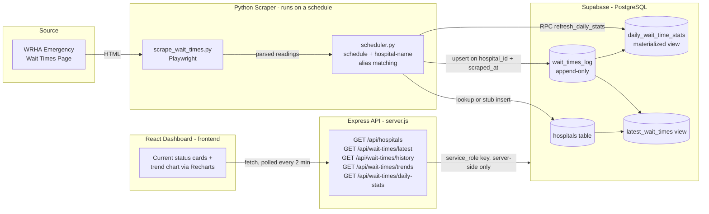

# Winnipeg ER Tracker

Real-time emergency room wait time tracking and analytics dashboard for the Winnipeg Regional Health Authority (WRHA). The app scrapes live wait-time data published by Shared Health Manitoba, stores a historical time series in Postgres, and serves a live dashboard with current status and trend charts for every WRHA emergency department and urgent care site.

## Key Findings

Based on 556 snapshots from 2026-08-19 to 2026-11-06. Urgent care sites only started being collected on 2026-11-06, so these cover the four emergency departments. Explore them on the dashboard's **Findings** tab, or read the SQL in [`queries/`](queries).

- **Waits follow the clock.** Averaged across sites, waits are shortest around 7 AM (about 7.2 hours) and longest from 8 PM to midnight (about 10 hours), so an evening arrival sees a posted wait about 2.7 hours longer.
- **St. Boniface is the longest typical wait.** Its median is 11.5 hours, against 10 at Grace, 9.75 at HSC Adult and 4 at HSC Children's. About one in seven St. Boniface readings sits at the 15-hour ceiling.
- **The 15-hour cap hides the worst days.** St. Boniface hit it in 14.2% of readings, across 25 days, including a run of 14 straight readings. HSC Adult hit it in 5.7% and Grace in 2.3%. HSC Children's never did.
- **Weekends aren't reliably worse.** HSC Children's and HSC Adult ran longer on weekends (41 and 26 minutes). Grace and St. Boniface ran shorter (24 and 55 minutes). All four differences are under an hour.
- **Waits rose going into October.** The monthly average of the seven-day mean climbed from September to October at every site: HSC Adult from 9.7 to 10.9 hours, HSC Children's from 4.3 to 5.2, St. Boniface from 10.6 to 11.9. One autumn can't show whether that's seasonal.

### Forecast Evaluation

Could tomorrow's wait be predicted better than by assuming it matches last week? [`analysis/forecast.py`](analysis/forecast.py) trains a random forest on information at least 24 hours old, then scores it against the "same hour last week" baseline on the same 233 held-out readings from Oct 10 to 26.

| Site | Baseline MAE (min) | Model MAE (min) |
|---|---:|---:|
| HSC Adult | 98.0 | 95.9 |
| HSC Children's | 118.0 | 82.4 |
| Grace | 141.0 | 106.5 |
| St. Boniface | 91.1 | 114.9 |
| **All sites** | **114.1** | **98.1** |

The model cuts average error by 14%, but it isn't a clear win. It helps most at HSC Children's and Grace, barely moves HSC Adult, and does worse than the baseline at St. Boniface. An error of about 1.6 hours is also large next to the 2.7-hour daily swing. The strongest feature is simply each site's recent average, so most of its value is knowing the current level. Treat this as a first result: it rests on one 17-day test window and about 790 training readings. Run it again with `python analysis/forecast.py` as data accumulates.

## Key Features

- **Real-time wait-time metrics** — current wait time, patients waiting, and urgency status for every tracked hospital, sourced directly from the WRHA emergency wait times page.
- **Auto-refresh polling** — the dashboard polls the API every 2 minutes for the latest snapshot, so the "Current Status" view stays up to date without a manual refresh.
- **Findings page** — a heatmap of waits by hour, p50/p90 rankings, cap rates, weekday vs weekend, and a rolling trend, with headlines worked out from the data.
- **Trend visualization** — a multi-line chart (6h / 12h / 24h / 48h ranges) shows historical wait times per hospital, with per-hospital toggles and a custom tooltip.
- **Canonical hospital matching** — the scraper's raw facility names are normalized against an alias table before being matched to the canonical `hospitals` record, so a page copy change (e.g. "Health Sciences Centre - Adult" vs. "...Adult Emergency") doesn't spawn duplicate hospital rows.
- **Resilient error recovery** — scrape failures (site down, page structure changed, zero rows parsed) are caught and recorded in `scrape_runs` instead of crashing the scheduler, so gaps in the time series are visible rather than silent.

## Tech Stack

| Layer | Technology |
|---|---|
| Scraper | Python, [Playwright](https://playwright.dev/python/) (headless Chromium — navigation, DOM querying, and parsing) |
| Scheduling | Python, [`schedule`](https://schedule.readthedocs.io/) |
| Database | [Supabase](https://supabase.com/) (managed PostgreSQL), with a materialized view for daily aggregates |
| Backend API | Node.js, [Express](https://expressjs.com/), [Helmet](https://helmetjs.github.io/), `express-rate-limit`, `@supabase/supabase-js` |
| Frontend | [React 19](https://react.dev/), [Vite](https://vite.dev/) |
| Styling / UI | [Tailwind CSS v4](https://tailwindcss.com/), [shadcn/ui](https://ui.shadcn.com/), Radix UI primitives |
| Charts | [Recharts](https://recharts.org/) |

> **Note:** the scraper parses the page using Playwright's own DOM query API (`page.query_selector_all`) rather than BeautifulSoup — there's no `beautifulsoup4` dependency in this codebase. Flagging this in case BeautifulSoup is expected elsewhere in your toolchain; happy to add it if there's a reason to prefer it over Playwright's built-in querying.

## Architecture & Data Flow



1. **Scrape** — `scrape_wait_times.py` launches headless Chromium via Playwright, visits WRHA's two wait-time pages (emergency departments and urgent care centres publish separately; see `SOURCES`), and parses each facility's row (facility name, patients waiting, raw wait-time string) into structured minutes (`parse_wait_minutes` handles both `"2h 15m"` and decimal formats like `"12.75 hrs"`).
2. **Store** — `scheduler.py` runs on an interval (`SCRAPE_INTERVAL_MINUTES`, default 30), resolves each scraped facility name to a canonical `hospitals.id` (via `HOSPITAL_NAME_ALIASES` and a cached lookup, inserting a stub row only for genuinely unknown facilities), and upserts one row per hospital into `wait_times_log`. Every cycle, including a failed one, is recorded in `scrape_runs`, and the `daily_wait_time_stats` materialized view is refreshed via an RPC call after each successful cycle.
3. **Serve** — `server.js` is a read-only Express API that queries Supabase with the service-role key (never exposed to the browser) and exposes `/api/hospitals`, `/api/wait-times/latest`, `/api/wait-times/history`, `/api/wait-times/trends`, `/api/wait-times/daily-stats`, `/api/findings`, and `/api/health/scrape`, all protected by Helmet, a CORS allowlist, and rate limiting.
4. **Display** — the React frontend talks only to the Express API (never directly to Supabase — see `frontend/src/lib/api.js`), polling `/api/wait-times/latest` every 2 minutes and re-fetching `/api/wait-times/trends` whenever the selected time range changes.

## The 15-Hour Cap

The source never reports a wait above "15 hrs": across nearly 2,000 valid readings the highest value is exactly 15 hours, reached 116 times through 2026-11-06, with quarter-hour values climbing right up to it. WRHA doesn't document a cap, so this is inferred from the data, but it means a reading of 15 hours is best read as "15 hours or longer". Statisticians call this right-censoring.

`wait_capped` flags those readings. `raw_wait_time` and `wait_time_minutes` keep exactly what was published.

- **Means exclude capped readings**, because 900 isn't their true value. This still understates the worst days, since the longest waits are the ones removed, so read the mean alongside the capped count.
- **Medians and percentiles include them.** These only depend on rank, and "at least 900" ranks correctly, so they stay valid unless the percentile itself lands on the cap.
- **The dashboard shows "15h+"** for a capped reading.

## Scrape Reliability

The scraper runs on a GitHub Actions cron set to every 30 minutes, but that isn't what happens in practice. Through 2026-11-06 the log holds 555 snapshots over 69 active days, about 8 a day instead of 48, with a median gap of 154 minutes.

- **Why runs are missing:** GitHub treats cron as best-effort and delays or drops scheduled runs under load, so a 30-minute schedule on free runners is a request, not a guarantee. The cron now sits on minutes 7 and 37, away from the busiest marks, which should help but won't reach 48 a day.
- **Why there's an 11-day hole:** GitHub disables scheduled workflows in public repositories after 60 days without repository activity. The last commit was 2026-08-26 and the last scheduled run was 60 days later, on 2026-10-25 local time. Nothing ran again until a manual trigger on 2026-11-06.
- **What guards against it now:** `watchdog.yml` runs every 6 hours, re-enables the scheduled workflows, and fails if the newest successful scrape is more than 6 hours old. GitHub emails you when it fails. `/api/health/scrape` reports the same thing over HTTP.
- **Failures are visible now:** `scrape_runs` records every cycle, and `python scheduler.py --once` exits non-zero on a failed or partial cycle, so the Action turns red instead of reporting success.

GitHub doesn't document whether the API re-enable call resets the 60-day timer, so treat the keep-alive as unproven until it has lived through a quiet period. The freshness check is the backstop. For a steadier cadence, a free external scheduler such as cron-job.org can call the [`workflow_dispatch` API](https://docs.github.com/en/rest/actions/workflows#create-a-workflow-dispatch-event) every 30 minutes, using a fine-grained token limited to this repository's Actions.

## Data Limitations

- **Sampling is uneven.** Snapshots average about 8 a day, not 48, and depend on when GitHub runs the job. Some site-and-hour cells have fewer than 10 readings, so the heatmap shows reading counts and blanks anything under 5.
- **There are holes.** Nothing was collected from 2026-10-26 to 11-06, and Grace is missing from the source for stretches, so it has 311 readings against 548 for the other emergency departments.
- **Urgent care history starts on 2026-11-06.** Concordia, Seven Oaks and Victoria were never scraped before then, and earlier `no_data` rows for them are placeholders rather than outages.
- **Waits are censored at 15 hours.** Means leave capped readings out, which understates the busiest sites. St. Boniface's mean (11.0 hours) sits below its median (11.5) for that reason.
- **Posted waits aren't patient outcomes.** WRHA's figure is a system-level estimate, and sicker patients are seen first, so any one person may wait more or less.
- **Under three months of data.** There's no full year behind this, so seasonal patterns can't be separated from one-off events.

## Testing

```bash
pip install -r requirements-analysis.txt
playwright install chromium
python -m pytest
```

The tests run offline against saved HTML and fake database clients. They cover parsing, cap detection, name matching, scrape outcomes and the forecast's protection against using future data.

## Adding Another Province

The project is built around one health authority, but the pieces separate cleanly. To add one:

1. **Add a `province` column.** Add `province TEXT NOT NULL DEFAULT 'MB'` to `hospitals` in a new migration, and include it in the `analysis_*` views you want to split by province.
2. **Write one scraper per province.** Move each source into `scrapers/<province>.py`, with a function that returns the records `build_hospital_record` produces today. Sites differ too much to share parsing, so share only the record shape.
3. **Register the scraper.** Have `run_cycle` loop over a list of scraper functions. A failure in one province then shows up as `partial` instead of stopping the others.
4. **Seed the hospitals.** Add rows with the right `province`, `region` and `type`, and add name aliases if the source abbreviates.
5. **Check the source's rules.** Confirm the site allows automated access, and find out what its wait means. Provinces define wait times differently, and each may have its own cap, so `WAIT_CAP_MINUTES` should become per-province.
6. **Filter the API.** Add a `province` query parameter to the read endpoints and a selector to the dashboard.

## Project Structure

```
Winnipeg_ER_Tracker/
├── scrape_wait_times.py     # Playwright scraper — reads live wait times from the WRHA site
├── scheduler.py              # Runs the scraper on an interval, upserts into Supabase
├── check_heartbeat.py        # Fails if no scrape has succeeded recently (run by watchdog.yml)
├── schema.sql                 # Supabase/Postgres schema: tables, indexes, views, RLS policies
├── functions.sql              # Postgres RPC function (refresh_daily_stats) used by the scheduler
├── migrations/                # Numbered, re-runnable changes for an existing database
├── queries/                   # Commented analysis SQL behind the Findings page
├── analysis/                  # Forecast against the same-hour-last-week baseline
├── docs/data_dictionary.md    # Every table, column and view
├── tests/                     # Offline pytest suite
├── findingsRoutes.js          # /api/findings, served from the analysis views
├── server.js                  # Express API — reads Supabase, serves the frontend
├── requirements.txt            # Python dependencies
├── package.json                 # Node dependencies for the Express API
├── .env.example                  # Backend env var template
└── frontend/                      # Vite + React dashboard
    ├── src/
    │   ├── components/            # HospitalCard, WaitTimeTrendChart, findings/, shadcn/ui primitives
    │   ├── hooks/                  # useLatestWaitTimes, useTrends, useNow
    │   └── lib/                     # api.js (Express client), utils.js
    └── .env.local                   # Frontend env var (not committed)
```

## Local Setup

### Prerequisites

- Node.js 20+ and npm
- Python 3.10+
- A [Supabase](https://supabase.com/) project (free tier is sufficient)

### 1. Database

In the Supabase SQL editor, run `schema.sql` then `functions.sql`, in that order. This creates the `hospitals` and `wait_times_log` tables (seeded with the seven WRHA sites the scraper covers), the `daily_wait_time_stats` materialized view, the `latest_wait_times` view, row-level security policies, and the `refresh_daily_stats()` RPC function.

### 2. Backend (scraper + scheduler + API)

```bash
# From the project root
cp .env.example .env      # fill in SUPABASE_URL, SUPABASE_SERVICE_KEY, etc.

# Python: scraper + scheduler
pip install -r requirements.txt
playwright install chromium
python scheduler.py        # runs continuously, scraping on SCRAPE_INTERVAL_MINUTES

# Node: Express API (in a separate terminal)
npm install
npm start                   # serves the API on PORT (default 4000)
```

`SUPABASE_URL` must be the bare project domain (e.g. `https://xxxx.supabase.co`) — `@supabase/supabase-js` and `supabase-py` both append `/rest/v1` themselves, so including it in the env var produces a doubled, invalid path.

### 3. Frontend

```bash
cd frontend
echo "VITE_API_URL=http://localhost:4000" > .env.local
npm install
npm run dev                  # http://localhost:5173
```

## Environment Variables

### Root `.env` (backend — see `.env.example`)

| Variable | Required | Description |
|---|---|---|
| `SUPABASE_URL` | Yes | Bare Supabase project URL, no path suffix |
| `SUPABASE_SERVICE_KEY` | Yes | Supabase **service role** key — server-side only, never sent to the browser |
| `FRONTEND_ORIGIN` | Yes | Origin allowed by the Express API's CORS policy (e.g. `http://localhost:5173`) |
| `PORT` | No (default `4000`) | Port the Express API listens on |
| `NODE_ENV` | No | `development` enables the local frontend origin and permissive server-to-server CORS |
| `SCRAPE_INTERVAL_MINUTES` | No (default `30`) | How often `scheduler.py` re-scrapes the WRHA page |

### `frontend/.env.local` (not committed)

| Variable | Required | Description |
|---|---|---|
| `VITE_API_URL` | Yes | Base URL of the Express API (e.g. `http://localhost:4000`) |

See `env-security-guide.md` for a deeper walkthrough of where each secret is allowed to live and why the service-role key must never reach the frontend.

## Data Attribution

Wait time data is sourced from Shared Health Manitoba / the Winnipeg Regional Health Authority (WRHA)'s public wait-time pages for [emergency departments](https://wrha.mb.ca/wait-times/emergency/) (St. Boniface, HSC Adult, HSC Children's, Grace) and [urgent care centres](https://wrha.mb.ca/wait-times/urgent-care/) (Victoria, Seven Oaks, Concordia); see `SOURCES` in `scrape_wait_times.py`. Pan Am Clinic is a minor injury clinic with no published wait times, so it isn't tracked. This project is an independent, unofficial tool and is not affiliated with, endorsed by, or operated on behalf of Shared Health Manitoba, the WRHA, or the Government of Manitoba. Wait times are self-reported by each facility, updated on their own schedule, and may be delayed, unavailable, or inaccurate at any given time — **do not use this dashboard to make medical decisions or in place of calling 911 in an emergency.**
